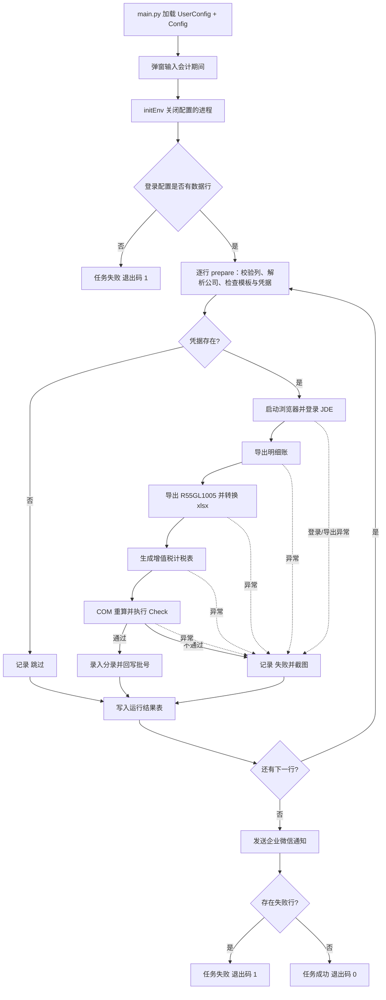

# JDE 增值税 RPA 程序说明文档

编写日期：2026-11-19。本文依据当前根目录源代码编写，面向使用、运维及后续开发人员；功能描述以代码实现为准。

本程序参考 `taiguhui-jde-flow-main/taiguhui-jde-flow-main`（下称“参考程序”）的框架与 JDE 已开发模块重建，**未修改参考程序目录**。复用的规则包括：Excel 配置读取、Windows 通用凭据读取、共享盘路径解析、JDE 登录、明细账导出、R55GL1005 导出与转换、日记帐分录录入、Excel COM 重算、运行结果表和企业微信通知。业务部分由房产税改为增值税，工作表、Check 规则、分录区和输出命名均按增值税模板调整。

## 0. 版本说明（2026-11-19）

- 主流程按「登录配置」页逐行执行：每一行是一个「Windows 凭据 + 共享盘目录」，完整跑一遍登录、导出、生成计税表、Check 检查和分录录入。
- 每行执行结果写入年度运行结果表，全部行结束后按 `通知配置` 页的 `WechatRobotN` 项发送企业微信通知。
- 运行前弹出会计期间输入框，留空或 60 秒无操作按自然月运行。
- 明细账导出期间为**会计期间当月及往前三个月，共四个月**；公司代码取自本行共享盘路径末段（如 `太古汇 2501` → `02501`），并按「单据 公司」等于该代码筛选后，再按标题写入模板的 `JDE明细账` 页。
- R55GL1005 取**本次会计期间**的数据，写入模板的 `上月留抵` 页；模板中写作“上月留底”时同样可识别。
- 生成文件统一命名为 `增值税计税表 {公司简称} {YYYYMM}.xlsx`，放在本行共享盘目录；明细账、R55 原始文件与中间结果放在框架输出目录的数据子目录。
- Check 检查 `计税收入` 页第一个 `Subtotal:` 行下方一行中 13%/9%/6% 税额差额，绝对值不得超过 5 元；不通过则跳过分录录入并把该行记为失败。
- 分录区支持同一工作表内左右并排两组「账号 / 借项金额 / 贷项金额 / 备注」表头，按从左到右、左表在上的顺序拼接后写入 JDE。
- 分录录入复用参考程序的 JDE 模块。`增值税配置.分录保存` 默认 `False`：粘贴后取消、不保存，仅用于联调；设为 `True` 时跳过“取消”步骤、保留分录界面，是否最终落库仍以 JDE 保存/提交为准。

## 1. 程序概述

本项目使用 Python 开发，通过 Playwright 操作 JDE 网页，通过 openpyxl 读写工作簿，通过 Windows COM（Excel/WPS）转换旧版 `.xls`、写入模板、重算公式和回写批号。

单行业务链路：

```text
读取配置 → 会计期间弹窗 → 初始化环境 → 启动浏览器 → 登录 JDE →
导出明细账 → 导出 R55GL1005 → 生成增值税计税表 →
COM 重算并执行 Check → 录入日记帐分录 → 回写批号 →
关闭浏览器 → 写入运行结果表
```

全部行结束后发送企业微信通知，并根据是否存在失败行决定任务结果。

### 1.1 当前实现范围

| 模块 | 当前能力 | 实现状态 |
| --- | --- | --- |
| 一：登录 JDE | 按行读取 Windows 通用凭据，填写环境、角色并登录 | 已实现（复用） |
| 二：导出明细账 | 按共享盘公司代码、会计期间当月及前三个月导出明细账并下载 | 已实现（复用） |
| 二续：导出 R55GL1005 | 运行 R55GL1005，下载 `.xls` 并转换为 `.xlsx` | 已实现（复用） |
| 三：生成计税表 | 复制/转换模板，筛选导入 `JDE明细账`，写入 `上月留抵`，更新会计期间 | 已实现 |
| 四：Check 检查 | 重算后检查 `计税收入` 第一个 `Subtotal:` 下方 13%/9%/6% 税额差额 | 已实现 |
| 五：写入分录 | 动态定位左右两组分录区，拼接后粘贴 JDE，并回写批号 | 已实现（分录保存默认关闭） |
| 批量调度 | 按「登录配置」逐行运行、结果表、企业微信通知 | 已实现（复用） |

**任务退出码只表示批量是否发生失败，不表示业务是否全部保存。** `分录保存=False` 时，分录在 JDE 中被取消、不落库；出现「待补运行」时任务仍可能返回成功。

## 2. 项目结构与职责

```text
项目根目录/
├── main.py                         主程序入口（配置、弹窗、初始化、主任务）
├── run.bat                         Windows 启动脚本（优先使用 .venv）
├── requirements.txt                Python 依赖清单
├── 程序说明文档.md                 本文档
├── config/
│   ├── config.py                   配置合并、目录生成与配置归档
│   └── config_loader.py            Excel 配置读取、多行配置、ConfigError
├── core/
│   ├── task_base.py                任务执行、日志、状态与耗时管理
│   └── context.py                  共享配置、业务数据与浏览器实例
├── data/
│   ├── Config.xlsx                 系统配置（JDE、增值税、登录、通知）
│   └── UserConfig.xlsx             用户配置（基础配置、目录配置）
├── workflows/vat_flow/
│   ├── main_task.py                逐行编排、逐行参数、结果表与通知
│   ├── login_task.py               获取凭据并执行登录
│   ├── vat_flow.py                 模块二至五编排
│   ├── vat_update.py               模板转换、明细账导入、上月留抵、会计期间
│   ├── vat_check.py                Subtotal 税额检查与分录区定位
│   ├── template_check.py           COM 重算、旧版 .xls 转 .xlsx
│   └── run_report.py               运行结果表与企业微信通知
├── web/
│   ├── browser.py                  Playwright 浏览器封装
│   └── JDE/jde_function.py         JDE 登录、明细账/R55GL1005 导出、分录录入
├── utils/
│   ├── credentials.py              Windows 通用凭据读取
│   ├── period_dialog.py            会计期间输入弹窗
│   └── helpers.py                  时间戳、目录、耗时格式化、重试装饰器
├── init/init.py                    进程清理
├── log/loggingConfig.py            日志初始化
└── log_data/                       运行日志（运行时生成）
```

## 3. 环境与安装

### 3.1 运行条件

- Windows 桌面环境：配置弹窗、Windows 通用凭据、COM 调用均依赖 Windows。
- Python 3（项目未固定版本），需能安装 Playwright 与 pywin32。
- 可访问目标 JDE 系统的网络环境。
- 当前 Windows 登录用户下已保存对应的「通用凭据」。
- 安装 Microsoft Excel（默认 `Excel.Application`），并具备写入 Excel「受信任位置」的权限（R55GL1005 转换需要）。
- 共享盘目录可读写（模板与输出均位于共享盘）。

### 3.2 依赖

以 `requirements.txt` 为准：`openpyxl>=3.1.0`、`Pillow>=10.0.0`、`psutil>=5.9.0`、`pywin32>=305`、`playwright>=1.40.0`、`uiautomation>=2.0.0`，以及 `requests`。另需标准库 `tkinter`（会计期间弹窗）。

### 3.3 安装

```powershell
python -m venv .venv
.\.venv\Scripts\Activate.ps1
python -m pip install -r requirements.txt
python -m playwright install chromium
```

### 3.4 Excel 与受信任位置

- R55GL1005 的 `.xls` 模板自带宏，处理逻辑挂在 `Workbook_Open` 事件上。
- 转换时先把文件复制到 Excel「受信任位置」再打开，并设置 `AutomationSecurity=1`（等同点击“启用内容”）；**不能关闭 `EnableEvents`**，否则宏不执行。
- 找不到可写的受信任位置时，日志会告警，宏可能不运行，转换结果需人工比对。
- 受信任目录会跳过 `XLSTART`，避免 Excel 启动时自动加载临时文件；转换完成后临时文件会被删除。

## 4. 配置说明

### 4.1 配置文件与加载规则

主入口加载 `data/UserConfig.xlsx`（用户配置）与 `data/Config.xlsx`（系统配置），两个文件都必须存在：

- 普通配置页：第 1 行为标题，第 2 行起 A 列为配置项、B 列为值；C 列说明不读取。A 列为空或 B 列为 `None` 的行不载入。
- 多行配置页（如「登录配置」）：第 1 行作为列标题，第 2 行起每行一条记录；全空行跳过；字符串去除首尾空格。
- 同一 `工作表.配置项` 以 `UserConfig.xlsx` 为优先，其余由 `Config.xlsx` 补充。
- 多行配置页在 `UserConfig.xlsx` 中无数据行时，回落到 `Config.xlsx` 的同名页；用户页有数据时以用户页为准。
- 程序用 `工作表名.配置项` 访问配置，例如 `JDE配置.jde_url`；`Config.get_rows(页名)` 读取多行配置。
- 值为 `None` 的配置项不会载入，代码按默认值处理；运行时覆盖值通过 `Config.set()` 写入。

`main.py` 的配置路径为相对 `main.py` 所在目录的 `./data/UserConfig.xlsx` 与 `./data/Config.xlsx`。

### 4.2 基础配置与目录配置

| 工作表 | 配置项 | 默认值 | 说明 |
| --- | --- | --- | --- |
| 基础配置 | 项目名称 | `增值税流程` | 用于工作目录名称 |
| 基础配置 | 基础路径 | `./data` | 相对路径按配置文件所在目录的上一级解析，默认即项目根目录 |
| 基础配置 | 初始化进程列表 | 空 | 英文或中文逗号分隔；按进程名**子串匹配**终止进程 |
| 目录配置 | 配置目录 | `01_配置` | 两个配置工作簿的归档目录 |
| 目录配置 | 输入目录 | `02_输入` | 手工模板、明细账等输入 |
| 目录配置 | 输出目录 | `03_输出` | 明细账、R55 报表以及按行创建的数据目录 |
| 目录配置 | 日志目录 | `04_日志` | 运行结果表写入此目录；业务日志仍在 `log_data` |
| 目录配置 | 截图目录 | `05_错误截图` | 失败截图 |
| 目录配置 | 临时目录 | `06_临时文件` | 预留 |

工作目录为 `基础路径/项目名称/目录名称`。`main.py` 启动时会创建全部目录，并把两个源配置工作簿复制到配置目录（仅在目标不存在时复制）。

`initEnv()` 按「初始化进程列表」关闭进程，属于子串匹配，例如配置 `excel` 会关闭所有名称包含 `excel` 的进程；启动前应保存相应应用中的数据。

### 4.3 JDE配置

| 配置项 | 必填 | 说明 |
| --- | --- | --- |
| jde_url | 是 | JDE 登录地址；任务启动前校验非空，为空直接失败 |
| jde_credential_name | 是 | Windows 通用凭据目标名称；主流程中会被「登录配置」的 `window凭据` 逐行覆盖 |
| jde_environment | 否 | 登录环境，如 `JPD920`；非空时填写 |
| jde_role | 否 | 登录角色，如 `*ALL`；非空时填写 |
| headless | 否 | 默认 `False`；字符串接受 true/false、1/0、yes/no（不区分大小写），其他值报错 |

- 登录时环境变量 `JDE_URL`、`JDE_ENVIRONMENT`、`JDE_ROLE` 分别覆盖对应配置值；即使设置了 `JDE_URL`，仍要求配置文件中的 `jde_url` 非空。
- 账号密码不从环境变量读取：`utils/credentials.py` 用当前 Windows 用户调用 `CredRead(..., CRED_TYPE_GENERIC, ...)`，密码按 UTF-16-LE 解码。

凭据读取结果与处理方式：

| 情况 | 处理 |
| --- | --- |
| 凭据名称为空 | `ValueError`；主流程中会先被「登录配置」必填校验拦截 |
| 凭据不存在（WinError 1168） | 抛出 `CredentialNotFoundError`，该行记为「跳过」，不计失败 |
| 其他读取失败（权限、类别错误等） | 抛出 `RuntimeError`，该行记为「失败」 |
| 用户名为空或密码为空 | 抛出 `RuntimeError`，该行记为「失败」 |
| 密码不是有效 UTF-16-LE | 抛出 `RuntimeError`，该行记为「失败」 |
| 未安装 pywin32 | 抛出 `RuntimeError`，该行记为「失败」 |

凭据存在时，「登录配置」中的 `凭据账号` 会与凭据用户名的域前缀之后部分比较（忽略大小写）；不一致只记录 warning，仍使用凭据中的真实账号登录。

配置凭据：Windows「凭据管理器 → Windows 凭据 → 添加普通凭据」，填写目标名称、用户名、密码，再把目标名称填入 `window凭据` 或 `jde_credential_name`。

### 4.4 登录配置（多行，主流程入口）

「登录配置」页每一行对应一个账号与一个共享盘目录，程序按行完整跑一遍流程。

| 列名 | 必填 | 说明 |
| --- | --- | --- |
| window凭据 | 是 | Windows 通用凭据目标名称 |
| 凭据账号 | 是 | 与该凭据用户名比对，仅用于告警，不参与登录 |
| 共享盘路径 | 是 | 目录绝对路径，末段必须是「公司简称 公司代码」两个词，如 `N:\...\太古汇 2501` |

校验与派生规则：

- 三个必填列任一为空：该行报错并记为失败，其他行继续。
- 共享盘路径末段必须恰好两个词且第二个为纯数字；否则该行失败。
- 公司简称取末段第一个词，用于模板名与计税表文件名；公司代码取第二个词并左补零到 5 位（`2501` → `02501`）。该代码用于明细账自公司/至公司、分录公司和 `JDE明细账` 的「单据 公司」筛选。
- 共享盘目录下必须存在模板 `增值税计税表 {公司简称}.xlsx`；不存在时回退查找同名 `.xls`。两者都没有则该行失败。
- 数据目录为 `输出目录/{公司简称} {公司代码} {YYYYMM}`，每行独立，自动创建。
- 行内其它列不读取，可自行保留备注。

### 4.5 增值税配置

以下配置项可写在任一配置工作簿的 `增值税配置` 页。主流程会在每行执行前用「登录配置」覆盖公司与路径相关键（见 5.2）。

| 配置项 | 默认值 | 主流程是否覆盖 | 说明 |
| --- | --- | --- | --- |
| 会计期间 | 空 | 由弹窗写入 | 空或仅空格按当月；支持 `YYYY-MM`、`YYYY/MM`、`YYYYMM`、`YYYY年M月`；用于文件名、明细账四个月区间与结果表期间 |
| 公司 | 空 | 是 | 文件名用公司简称；不得含 `<>:"/\|?*` 等非法字符 |
| 模板文件 | 空 | 是 | 显式模板路径；相对路径按输入目录解析；主流程固定为共享盘模板 |
| 输出目录 | 空 | 是 | 空时用框架输出目录；相对路径作为框架输出目录的子目录；主流程为共享盘目录 |
| 明细账文件 | 空 | 是 | 导出目标；相对路径按输出目录解析；主流程为数据目录下的无后缀名 |
| 明细账分类帐类型 | `AA` | 否 | 明细账查询的分类账类型 |
| 明细账自公司 | 空 | 是 | 导出必填；主流程从共享盘路径末段解析公司代码后覆盖 |
| 明细账至公司 | 空 | 是 | 导出必填；主流程从共享盘路径末段解析公司代码后覆盖 |
| R55GL1005文件 | 空 | 是 | 当期报表目标；相对路径按输入目录解析；主流程为数据目录下的 `.xlsx` |
| 分录公司 | 空 | 是 | 分录 Document Company；主流程从共享盘路径末段解析公司代码后覆盖 |
| 核对容差 | `5` | 否 | Subtotal 下方 13%/9%/6% 税额差额的绝对值上限（元） |
| 重算引擎 | `Excel.Application` | 否 | WPS 可尝试 `ket.Application` |
| 分录保存 | `False` | 否 | `False` 为联调模式（粘贴后取消不保存）；`True` 跳过取消、保留分录界面，是否落库以 JDE 保存/提交为准 |

模板内部工作表名与标题行使用代码默认值，通常无需配置：

- 明细账：源文件取第一张工作表，模板页为 `JDE明细账`，标题行为第 1 行；
- 计算底表：`增值税计算底表`，用于会计期间、批号和分录区；
- 计税收入：`计税收入`，用于 Subtotal 检查；
- 申报主表：`主表`，用于税款所属期间文本；
- 上月留抵：`上月留抵`（兼容“上月留底”），写入当期 R55GL1005；
- 分录：`增值税计算底表`，读取分录区并回写批号；
- R55GL1005：取报表第一张工作表。

如模板结构调整，再在 `增值税配置` 页补充同名配置项覆盖默认值。

补充说明：

- 输出文件名统一为 `增值税计税表 公司 YYYYMM.xlsx`，期间取会计期间所在月。
- 模板中的 `JDE明细账` 标题必须与 JDE 导出的明细账标题一致；程序按规范化标题（忽略空白、下划线、连字符、括号，统一“帐/账”）自动映射。
- 会计期间写入 `增值税计算底表` 的 `会计期间：` 右侧单元格，值为当月首日，显示格式 `yyyy/m/d`（如 `2026/10/1`）。
- `计税收入!C4`、`代扣代缴!B2` 通过公式链接 `增值税计算底表!C4`；`封面!A4`、`业务信息表!A2` 通过公式链接 `主表!A2`，因此只需更新底表 C4 与主表 A2。

### 4.6 企业微信通知配置

配置工作簿的 `通知配置` 页按「配置项 / 值」两列登记机器人，每个 `WechatRobotN` 对应一个机器人：

| 配置项 | 值 | 说明 |
| --- | --- | --- |
| `WechatRobot1` | 机器人 Webhook 地址 | 第 1 个机器人，留空则跳过 |
| `WechatRobot2` | 机器人 Webhook 地址 | 第 2 个机器人，留空则跳过 |

- 配置项名称须匹配 `^WechatRobot\d+$`（不区分大小写），按编号排序后依次发送。
- 未配置 Webhook 的机器人跳过；单个机器人发送失败只记录 warning，不影响其他机器人。
- 先发送文本消息，再上传并发送运行结果表文件；上传失败视为该机器人发送失败。
- 没有任何可用机器人时只记录日志，不报错。

## 5. 主流程与业务规则



### 5.1 启动、会计期间弹窗与环境初始化

1. `main.py` 加载 `UserConfig.xlsx` 与 `Config.xlsx`，创建目录并归档配置。
2. 弹出 tkinter 输入框（置顶、居中）：
   - 输入合法期间（`2026-10`、`202610`、`2026/10` 等）并确定：写入 `增值税配置.会计期间`。
   - 留空确定、按 Esc、关闭窗口、60 秒无按键/点击或弹窗无法显示：清空会计期间，按当月运行。
   - 格式非法时红字提示并重置倒计时。
3. 调用 `initEnv()` 按配置关闭进程。
4. 创建 `VATMainTask` 并执行。

日志同时输出到控制台（stderr）与 `./log_data/YYYYMMDD_机器名.log`；该路径相对进程工作目录，`run.bat` 会先切到项目根目录。

### 5.2 主任务逐行编排

`VATMainTask.execute()`：

1. 校验 `JDE配置.jde_url` 非空。
2. 读取「登录配置」数据行；为空时直接失败，提示需要填写 `window凭据`、`凭据账号`、`共享盘路径`。
3. 计算本次会计期间标签（`YYYYMM`，空则当月）。
4. 逐行执行，每行开始前清空上下文中的 `vat_status`、`vat_pending_reason`、`jde_journal_batch`。

每行 `prepare()` 依次完成：

- 三列必填校验；
- 解析共享盘路径（公司简称、公司代码，代码补零到 5 位）；
- 检查共享盘与模板 `增值税计税表 {简称}.xlsx`（回退 `.xls`）；
- 读取凭据（不存在则抛 `SkipRun`，结束本行）；
- 计算会计期间、数据目录并创建；
- 写入以下覆盖项：

| 覆盖键 | 值 |
| --- | --- |
| JDE配置.jde_credential_name | 本行 `window凭据` |
| 增值税配置.公司 | 公司简称 |
| 增值税配置.模板文件 | 共享盘/`增值税计税表 {简称}.xlsx`（或 `.xls`） |
| 增值税配置.输出目录 | 共享盘目录 |
| 增值税配置.明细账自公司 / 至公司 | 5 位公司代码（共享盘路径解析） |
| 增值税配置.分录公司 | 5 位公司代码（共享盘路径解析） |
| 增值税配置.明细账文件 | 数据目录/`JDE明细账 {时间戳}`（无后缀） |
| 增值税配置.R55GL1005文件 | 数据目录/`R55GL1005_{时间戳}.xlsx` |

随后 `run_one()` 处理本行：新建 `BrowserManager`（`headless` 来自配置）、启动、执行 `JDELoginTask`、执行 `VatFlow`；异常时若页面可用则截图到 `05_错误截图/jde_failure_{简称}_{代码}.png`，最后在 `finally` 中关闭浏览器。

单行结果判定：

| 上下文 `vat_status` | 运行结果 | 是否计入失败 |
| --- | --- | --- |
| `completed` 或未设置 | 成功 | 否 |
| `pending` | 待补运行 | 否（异常情况写 pending 原因） |
| 其他值 | 失败 | 是 |
| prepare 抛 `SkipRun` | 跳过 | 否 |
| 其他异常 | 失败 | 是 |

每行无论成功、失败、待补运行还是跳过，都会立即写入运行结果表；全部行处理完后发送通知。只要存在失败行，通知发送后抛出 `ConfigError("以下账号执行失败：…")`，任务失败，`main()` 返回 `False`，退出码 1。

### 5.3 登录与浏览器管理

- 每次登录重试最多 3 次，间隔 5 秒；重试只包裹登录函数，不覆盖后续流程。
- `jde_login()`：打开 `jde_url`；若 `#drop_mainmenu` 5 秒内可见则视为已登录；否则按需点击 `Details`，填写 Environment、Role（非空时）、User ID、Password，点击 `Sign In`，等待主菜单 20 秒。
- 登录成功后设置上下文 `jde_logged_in=True`；浏览器在同行的导出、分录环节复用。

### 5.4 模块二：导出明细账

`VatFlow.export_ledger()`：

- 校验 `明细账自公司`、`明细账至公司` 非空，浏览器已打开。两者均为主流程从共享盘路径末段解析出的 5 位公司代码。
- 日期区间：从会计期间当月首日往前推 3 个月的首日，到会计期间当月最后一日，共四个月；统一格式化为 `MM/DD/YYYY`。例如会计期间 `2026-10`，区间为 `07/01/2026` 至 `10/31/2026`。
- 目标文件取 `明细账文件`（相对路径按框架输出目录解析），未配置时输出目录 `/增值税明细账 {时间戳}`；无后缀时按下载建议的文件名补后缀。
- 页面操作：选择页面 → 所有页面 → 总帐；按科目帐的帐户查询；填写分类帐类型 2（默认 `AA`）、自公司、至公司、起始日期、至日期；查找；转到结束；选择所有提取的记录；输出网格数据；本地文件系统 + 输出到 Excel + 新工作簿 + 所有；点击「继续」触发下载（超时 300 秒），保存到目标路径。
- 成功后设置上下文 `jde_ledger_path`。

### 5.5 模块二续：导出 R55GL1005

`VatFlow.export_r55gl1005()`：

- 校验 `明细账自公司`（主流程为 5 位公司代码）。
- **取数期间为本次会计期间**：例如本次会计期间为 `2026-10`，则导出 `2026-10` 的 R55GL1005，写入模板的「上月留抵」页（该页名称沿用模板，数据期间为当期）。
- 目标路径优先上下文 `jde_r55gl1005_path`，其次 `R55GL1005文件`（相对路径按输入目录解析），都没有时输出目录 `/R55GL1005_{时间戳}.xlsx`；后缀强制为 `.xlsx`。
- 页面操作：回到主页 → 总帐 → 中方科目总账；版本填 `TKHXLS001` 回车；选择所有提取记录 → 选择 → 数据选择 → 提交(U) → 确定；在 Company 选择框中填写去掉前导零的公司代码 → 确定 → 屏幕(F) → 已提交作业；「作业」框填 `R55GL1005_TKHXLS001` 回车。
- 作业定位：取「已提交作业」列表第一行（即本次提交），解析作业号后按作业号跟踪该行；页面不会自动刷新，轮询期间每 5 秒在「作业」框重新填作业名并回车；总轮询上限 120 秒。
- 状态判定：行文本包含「完成/Done」即完成；包含「错误/失败/Error」立即报错；超时或未完成不下载。
- 下载：点击「可单击图标 查看输出」，在原页面或新开页面监听下载，保存为同名 `.xls`（原始文件保留），随后转换为 `.xlsx`（同名不同后缀），并关闭下载过程中新开的页面。
- 转换规则：复制到可写的 Excel 受信任位置 → `AutomationSecurity=1` 打开 → 优先 `SaveAs(51)` 直接保存为 xlsx（保留格式）；被安全策略阻止时退回读取各表 UsedRange 值重建 xlsx（保留数值、文本及原行列位置，去除末尾空行空列，工作表名非法字符替换为 `_` 且不超过 31 字符并去重；公式与格式不保留），日志打印每张表的行列数。临时文件最终删除。
- 成功后设置上下文 `jde_r55gl1005_path`。

### 5.6 模块三：生成增值税计税表

`VatFlow.build_template(ledger_path, report_path)` 调用 `vat_update.build_workbook()`，在**同一个 Excel 会话**内完成以下步骤：

1. **模板解析**：`增值税配置.模板文件` 优先；否则在输入目录查找名称包含「增值税计税表」的 `.xlsx` 或 `.xls`，排除 `~$` 临时文件，必须唯一。
2. **公司校验**：`公司` 必填且不含 `<>:"/\|?*` 及控制字符。
3. **输出路径**：`输出目录`（主流程为共享盘）或框架输出目录；文件名为 `增值税计税表 {公司} {YYYYMM}.xlsx`。同名文件直接删除并覆盖。
4. **模板转换**：
   - 模板是 `.xlsx`：直接复制到输出路径。
   - 模板是 `.xls`：由 Excel 打开后 `SaveAs(51)` 另存为 `.xlsx`，保留公式、格式、合并单元格、图表与工作表。
5. **读取明细账**：用 openpyxl 读取 JDE 导出的明细账（第一张工作表，标题行为第 1 行），跳过全空行。
6. **按公司筛选**：把「单据 公司」规范化为 5 位字符串（`2501`、`02501`、数值 `2501` 均视为 `02501`），只保留等于公司代码的行。没有匹配行时直接失败。
7. **标题映射**：读取模板 `JDE明细账` 第 1 行标题，与源标题按规范化名称匹配：
   - 忽略空白、下划线、连字符、`+ / ( )`、全角括号；
   - 统一“帐/账/帳”；
   - 模板中所有非空标题必须在源表中存在，否则失败并列出缺失标题；
   - 源表中模板未使用的列只记录 warning，不写入。
8. **写入明细账**：
   - 清空模板 `JDE明细账` 标题行以下的旧内容（保留格式）；
   - 按模板列顺序生成对齐后的数据行，按 2000 行分批写入 Excel，避免 COM 大数组限制；
   - 整列都是文本的列先设为文本格式再写入，避免 `02501`、单据号等丢失前导零；写入后恢复模板原有格式；
   - 日期值转换为 Excel 日期序列号，避免 COM 时区偏差；
   - 文本以 `=` 开头时加单引号，避免被当成公式。
9. **写入上月留抵**：打开 R55GL1005 工作簿，取第一张工作表，解除模板 `上月留抵`（或 `上月留底`）页的合并区域、清空旧内容，然后整表复制报表的 UsedRange（值、格式、合并区域）。日志打印行列数。
10. **更新会计期间**：
    - 在 `增值税计算底表` 找到文字 `会计期间：`，把右侧单元格写为当月首日，显示格式 `yyyy/m/d`（如 `2026/10/1`）。
    - 在 `主表` 找到包含 `税款所属期间：` 的单元格（当前模板为 `A2`），保留前缀，把日期部分改写为 `YYYY年MM月DD日至YYYY年MM月DD日`（如 `2026年10月01日至2026年10月31日`）。
    - `计税收入!C4`、`代扣代缴!B2` 链接底表 C4；`封面!A4`、`业务信息表!A2` 链接主表 A2，无需单独写入。
11. **保存**：`book.Save()`，不在此处重算；随后的 Check 模块统一执行 `CalculateFullRebuild`，避免重复重算大工作簿。

生成后设置上下文 `vat_path`、`jde_ledger_rows`。

> 参考样例 `docs/增值税 太古汇 202610 (version 3).xls` 的工作表布局：`增值税计算底表` 的会计期间在 `B4/C4`、批号在 `B5/C5`，分录区表头在第 32 行，左侧 `C:F`、右侧 `H:K`；`计税收入` 有两个 `Subtotal:`（样例为 81、116 行），程序只校验第一个（81 行）的下一行税额差异；`主表` 的税款所属期间在 `A2`。模板调整后，程序按文字和标题动态定位，不依赖固定行号。

### 5.7 模块四：Check 检查

`VatFlow.check(path)`：

1. `recalculate_file(path, 重算引擎)`：启动独立 Excel 实例，隐藏窗口、关闭警告、`AutomationSecurity=3`，以 `UpdateLinks=0` 打开，`CalculateFullRebuild()` 后保存并关闭；文件被占用时报错。
2. 以 `data_only=True` 重新加载，定位 `计税收入` 工作表。
3. `vat_check.check_tax_differences()`：
   - 动态查找表头：找到一行中至少 3 个 `税额` 标题；再取上一行中的 `13%`、`9%`、`6%` 税率标题，把每个税率映射到其右侧最近的 `税额` 列。税率标题无法识别时按三个税额列的出现顺序回退。
   - 动态查找第一个 `Subtotal:` 行（不区分大小写，允许前后空格）；模板中可能有两个，只校验第一个。
   - 读取第一个 `Subtotal:` 行的下一行在 13%/9%/6% 税额列上的值。该行在模板中是 `Subtotal 税额 - 增值税计算底表对应税额` 的差异公式。
   - 值为空或非数值时直接失败，提示“公式未重算”；绝对值大于容差（默认 5）时该项不通过。
4. 逐项写日志与上下文 `vat_check_results`；状态写 `passed`/`failed`。
5. 任一项不通过时只打印 `表格核对失败：{不通过项}`、把失败原因写入 `vat_pending_reason` 并返回 `False`，不抛代码异常；`VatFlow.run()` 据此跳过分录，把本行标记为失败，主任务在运行结果表写入失败原因，日志中不会出现堆栈。
6. 全部通过时返回 `True`，进入模块五。

> 样例文件当前 `视同销售` 行未填数：第一个 Subtotal 的 13% 税额差额约为 `-272223.16`，因此 Check 会不通过。这属于业务数据未补齐，不是程序错误；补齐视同销售或对应的税额后重跑即可。

### 5.8 模块五：分录录入

`VatFlow.write_journal(path)`：

1. `journal_rows()` 读取 `增值税计算底表`：
   - `journal_regions()` 扫描所有行，按规范化标题（忽略空白、统一“帐/账”）查找 `账号 / 借项金额 / 贷项金额 / 备注` 四列。
   - 同一行可左右并排两组表头；遇到重复标题时切分新组，四列齐全即视为一个分录区。
   - 每个分录区以标题行下一行开始，以「最后一个有账号的行」为界；中间空白账号行不提前截断，只过滤四列全空的占位行。
   - 所有分录区按最左列排序（左表在前、右表在后），把行按顺序拼接；说明取第一条非空备注。
2. `create_journal_entry()`（复用 JDE 模块）：
   - 回主页 → 总帐 → 日记帐分录；点「增加 (Ctrl+Alt+A)」→「确定 (Ctrl+Alt+O)」；
   - 读取并记录 JDE 生成的批号；
   - 填写 Document Company（`分录公司`）、说明、总帐日期（当天，`MM/DD/YYYY`）；
   - 将四列按 Tab 分隔、行间换行的 TSV 写入系统剪贴板（数值去掉多余小数位，避免科学计数法）；
   - 选择分录方案（当前按显示名 `RPA` 选择；常量 GUID `8d5afde055f149ea973fb07587dafa28` 保留）；
   - 粘贴前校验网格列顺序：按表头文字确认「帐号、借项金额、贷项金额、备注」都存在且相对顺序一致（不要求连续）；读不到表头、缺列或顺序不符时**不执行粘贴**，先取消录入再报错；
   - 把焦点移到分录网格首格（只认网格内输入框获得焦点，失败即终止，避免粘贴到日期栏）；`Ctrl+V` 整块粘贴。
3. `增值税配置.分录保存`：
   - `False`（默认）：粘贴后在当前页面点一次「取消 (Ctrl+Alt+L)」；第二次取消可能不存在或出现在新页面，跨所有页面/frame 尽力查找，找不到只记日志，不影响流程，**不保存**。用于联调。
   - `True`：不执行取消，保留分录界面。是否最终落库仍以 JDE 的保存/提交操作为准；正式启用前需在真实环境确认保存/提交结果与批号持久化。
4. 把批号回写到 `增值税计算底表` 的 `批号：` 右侧单元格；设置上下文 `jde_journal_batch`、`jde_journal_rows`。

> 当前默认 `分录保存=False`，因此 JDE 中不会留下已保存的分录；批号仍会生成并回写。需要保留分录界面时把 `增值税配置.分录保存` 设为 `True`，并在测试环境确认 JDE 保存/提交结果。

### 5.9 运行结果表

- 位置：`04_日志/增值税计税表运行结果表-{当年年份}.xlsx`；首次创建时写标题并设置列宽、宋体居中、冻结首行。
- 每处理完一行追加一条记录，列：会计期间、公司、公司代码、分录批号、运行结果、异常情况、备注、运行开始时间、运行结束时间；异常情况自动换行，时间格式 `yyyy/m/d h:mm:ss`；自动维护筛选区域。
- `运行结果` 取值：成功、失败、待补运行、跳过。
- 公司/公司代码优先取 `prepare()` 解析值；`prepare()` 在解析公司前失败时，从共享盘路径重新解析，解析不了则保留原始路径。
- 结果表写入失败只记录 warning，不影响业务结果。

### 5.10 企业微信通知

- 通知文本：`各位好，请查收 {公司}_增值税计税表更新与分录录入，谢谢！`、`本次处理会计期间：{YYYYMM}`、`总处理行数：{N} 行，处理成功：{S} 个，失败/待补运行：{F} 个，具体查看《{结果表文件名}》`。
- 总处理行数不含「跳过」行；失败数 = 总处理行数 − 成功数（即失败 + 待补运行）。
- 公司列表为结果中出现的公司简称去重后以「、」连接；没有时取 `增值税配置.公司`，再没有用「太古汇」。
- 除文本外会尝试上传结果表文件并发送文件消息。

### 5.11 状态、异常与退出码

`TaskBase.run()` 捕获 `execute()` 的异常：正常返回即 `completed` 并返回 `True`；异常则 `failed` 并返回 `False`。`main()` 返回 True/False，`__main__` 转为退出码 0/1。

| 场景 | 任务状态 | 退出码 |
| --- | --- | --- |
| 所有行成功或跳过 | completed | 0 |
| 存在失败行 | failed（汇总报错） | 1 |
| 登录配置为空 | failed | 1 |
| `jde_url` 为空 | failed | 1 |
| 配置缺失/加载失败（主任务之前） | 未进入主任务，抛出异常 | 1 |
| 全部行跳过 | completed | 0 |

## 6. 使用步骤

### 6.1 首次准备

1. 安装依赖与 Chromium（见第 3 节）。
2. 在两个配置工作簿中填写 `基础配置`、`目录配置`、`JDE配置`、`增值税配置`、`登录配置`、`通知配置`（`WechatRobotN` 项）。
3. 在 Windows 凭据管理器中创建每行所需的通用凭据。
4. 在每个共享盘目录放置模板 `增值税计税表 {公司简称}.xlsx`；如只有旧版 `.xls`，可命名为 `增值税计税表 {公司简称}.xls`，程序会先另存为 `.xlsx`。模板需包含 `JDE明细账`、`增值税计算底表`、`计税收入`、`主表`、`上月留抵`、`月结日期`、`金税开票`、`代扣代缴` 等工作表及约定的 Check 区、分录区。
5. 在 Excel 信任中心添加可写的受信任位置（R55GL1005 宏需要）。
6. 正式运行前确认 `增值税配置.分录保存`：联调保持 `False`；需要保留分录界面时改为 `True`，并在 JDE 中完成保存/提交。

### 6.2 常规运行

```powershell
run.bat
```

或：

```powershell
python main.py
```

`run.bat` 优先使用 `.venv\Scripts\python.exe`，结束后显示「运行完成」或「运行失败，退出码：N」并暂停。

运行后检查：

- 控制台/`log_data` 日志中的逐行参数、跳过/失败原因、Check 明细、分录行数与批号；
- 运行结果表；
- 企业微信通知（如已配置）；
- 各行数据目录中的明细账、R55 报表与共享盘中的增值税计税表。

### 6.3 建议的联调顺序

1. 先用一行真实配置运行，确认登录、明细账导出、R55 导出与模板转换正常。
2. 检查生成的 `增值税计税表`：
   - `JDE明细账` 行数与「单据 公司」筛选结果一致，标题与数据未错列；
   - `上月留抵` 为当期 R55GL1005 数据，`增值税计算底表!B28` 的上月留抵取数正常；
   - `增值税计算底表!C4` 为当月首日，`主表!A2` 为正确所属期间。
3. 确认 Check 结果；如不通过，按日志中的差额与位置补齐业务数据后重跑。
4. 确认分录区拼接顺序、行数、说明与 JDE 网格列顺序；联调阶段保持 `分录保存=False`，确认后再改为 `True` 并在 JDE 中完成保存/提交。

## 7. 输出、日志与上下文

### 7.1 文件输出

| 输出 | 位置 |
| --- | --- |
| 增值税计税表 | 共享盘目录/`增值税计税表 {公司简称} {YYYYMM}.xlsx`（同名覆盖） |
| 明细账 | `03_输出/{公司简称} {代码} {YYYYMM}/JDE明细账 {时间戳}.xlsx` |
| R55GL1005 原始文件 | 同目录/`R55GL1005_{时间戳}.xls` |
| R55GL1005 工作簿 | 同目录/`R55GL1005_{时间戳}.xlsx` |
| 运行结果表 | `04_日志/增值税计税表运行结果表-{年份}.xlsx` |
| 配置归档 | `01_配置/UserConfig.xlsx`、`01_配置/Config.xlsx` |
| 运行日志 | 进程工作目录下 `log_data/YYYYMMDD_机器名.log` |
| 失败截图 | `05_错误截图/jde_failure_{公司简称}_{公司代码}.png` |

`04_日志` 目录会被创建，但 logger 实际仍写入 `log_data`（`config/config.py` 的 `PYHON_LOG_FOLDER_PATH = "./log_data/"`）。

### 7.2 失败截图

- 仅当浏览器页面仍可用时截图；`prepare()` 阶段失败（缺列、路径非法、模板缺失、凭据不存在）不截图。
- 文件名按公司与代码固定，同一公司后续失败会覆盖上一张。

### 7.3 上下文关键字段

| 字段 | 含义 |
| --- | --- |
| jde_logged_in | 登录成功标记 |
| jde_ledger_path | 本次导出的明细账路径（可预先注入） |
| jde_r55gl1005_path | 当期 R55GL1005 路径（可预先注入） |
| vat_path | 生成的增值税计税表路径 |
| jde_ledger_rows | 导入明细账的行数 |
| vat_check_status | `running`、`passed`、`failed` |
| vat_check_results | 逐项 Check 记录（核对项、差额、容差、通过、位置） |
| journal_required | 模块四返回的布尔决策 |
| jde_journal_batch / jde_journal_rows | 分录批号与行数 |
| vat_status | `running`、`pending`、`failed`、`completed` |
| vat_pending_reason | 待补运行或失败原因 |

上下文仅保存在内存中，不形成持久化状态文件。

## 8. 错误处理与常见问题

| 现象 | 原因与处理 |
| --- | --- |
| 启动即失败：配置文件不存在 | 检查 `data/UserConfig.xlsx`、`data/Config.xlsx` 是否存在 |
| 会计期间弹窗未出现 | tkinter 不可用或远程会话限制；程序会按自然月继续，日志有 warning |
| 整批不执行：登录配置无数据行 | 在「登录配置」页填写 `window凭据`、`凭据账号`、`共享盘路径` |
| 某行被跳过 | 该行 `window凭据` 在凭据管理器中不存在；确认名称或补齐凭据后重跑 |
| 某行失败：无法读取 Windows 通用凭据 | 凭据类别不是「通用凭据」、当前用户无权限或 pywin32 未安装 |
| 某行失败：共享盘路径末段格式不正确 | 目录名必须是「公司简称 公司代码」，如 `太古汇 2501` |
| 某行失败：共享盘缺少模板 | 目录下需要 `增值税计税表 {公司简称}.xlsx` 或同名 `.xls` |
| 浏览器无法启动 | 未安装 Chromium 或 Playwright 依赖缺失 |
| 登录失败 | 检查 `jde_url`、环境、角色、凭据；页面控件变化也会导致失败；最多重试 3 次 |
| 明细账导出超时 | 检查网络、查询条件、页面加载；网格 300 秒、下载 300 秒 |
| R55GL1005 作业长时间未完成 | 检查作业状态；轮询上限 120 秒，超时不下载 |
| R55GL1005 转换结果异常 | 检查是否配置了可写的 Excel 受信任位置、宏是否执行；日志会打印各表行列数 |
| 模板标题缺失/未映射 | 对照模板 `JDE明细账` 与导出明细账的标题，必要时调整模板或导出列 |
| 明细账筛选后为空 | 检查「单据 公司」是否为公司代码、导出条件是否包含该期间 |
| 明细账前导零丢失 | 程序对整列文本先设文本格式；如仍丢失，检查该列是否混有数值类型 |
| 输出与模板/明细账重合 | 调整模板、明细账或输出目录 |
| 提示“文件夹已存在同名输出文件”被覆盖 | 程序按参考程序规则同名覆盖，属预期行为 |
| COM 重算失败或文件被占用 | 关闭占用该文件的 Excel；检查重算引擎注册与写入权限 |
| Check 无法取数 | 公式未重算、`Subtotal:` 下方行缺失或税率/税额表头被改动；检查模板 `计税收入` 布局 |
| Check 差额超过 5 元 | 查看日志中的差额与单元格位置；补齐视同销售、进项税等业务数据后重跑 |
| 分录区未找到 | 检查 `增值税计算底表` 是否保留「账号 / 借项金额 / 贷项金额 / 备注」四个标题 |
| 分录网格列顺序不符 | JDE 分录方案或页面列顺序变化；程序会中止粘贴，需按表头调整后再运行 |
| 分录未出现在 JDE | `分录保存=False` 时粘贴后取消、不保存，属预期行为；改为 `True` 后重试，并在 JDE 中完成保存/提交 |
| 企业微信未收到通知 | 检查 `通知配置` 页 `WechatRobotN` 的 Webhook、网络；值为空时只记录日志 |

## 9. 测试与维护

### 9.1 语法与导入检查

```powershell
python -m compileall -q .
python -c "import workflows.vat_flow.main_task, workflows.vat_flow.vat_flow, workflows.vat_flow.vat_update, workflows.vat_flow.vat_check"
```

### 9.2 真实环境联调

- 使用 `docs/增值税 太古汇 202610 (version 3).xls` 作为模板参考，确认：
  - 工作表名称与配置一致；
  - `增值税计算底表` 的会计期间、批号、分录区位置；
  - `计税收入` 的 `Subtotal:` 行与税率/税额表头；
  - `主表` 的税款所属期间单元格；
  - `上月留抵` 与 R55GL1005 的列结构（尤其 `400946`/`14` 的上月留抵取数）。
- 先以 `分录保存=False` 验证导出、生成、Check、分录拼接与批号回写，再决定是否开启保留分录界面。

### 9.3 维护建议

1. 若 JDE 界面或作业名（`R55GL1005_TKHXLS001`）、版本（`TKHXLS001`）、分录方案名称/GUID 变化，需同步修改 `web/JDE/jde_function.py` 中的常量与定位方式。
2. 若模板调整了工作表名称，在 `增值税配置` 页补充同名 `*工作表` 配置项覆盖代码默认值。
3. 若 R55GL1005 取数期间需要调整，修改 `workflows/vat_flow/vat_flow.py` 的 `export_r55gl1005()` 中 `period` 赋值（当前取本次会计期间）。
4. 正式启用分录保存前，在测试环境确认保存/提交后的成功提示、批号持久化与冲销策略。
5. 失败截图按公司固定命名会覆盖，若需留档可改为带时间戳。

## 10. 与房产税参考程序的主要差异

| 项目 | 参考程序（房产税） | 本程序（增值税） |
| --- | --- | --- |
| 税种与模板 | `房产税计税表 {公司}.xlsx` | `增值税计税表 {公司}.xlsx`（支持 `.xls` 转换） |
| 明细账写入 | 按标题写入 `JDE明细账` | 同样按标题写入，但额外按「单据 公司」= 公司代码筛选 |
| R55GL1005 | 当期报表写入 `R55GL1005` 页 | 当期报表写入 `上月留抵` 页（页名为模板沿用） |
| 会计期间 | 计算底稿 `会计期间：` 右侧 | `增值税计算底表!C4` + `主表!A2` 税款所属期间文本 |
| Check | 税额/收入/审核差额/Check 合计多项 | `计税收入` 第一个 `Subtotal:` 下方 13%/9%/6% 税额差额 ≤ 5 元 |
| 分录区 | 单一区域（账号/借项/贷项/备注） | 同一行可左右两组，左表在上、右表在下拼接 |
| 分录保存 | 默认取消不保存 | 默认取消不保存，可由 `分录保存` 跳过取消（是否落库以 JDE 保存/提交为准） |
| 结果表 | `房产税计税表运行结果表-{年}.xlsx` | `增值税计税表运行结果表-{年}.xlsx` |
| 通知文案 | `{公司}_房产税计税表更新与分录录入` | `{公司}_增值税计税表更新与分录录入` |
